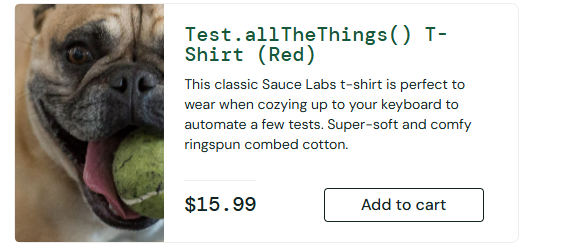

# Bug Reports: saucedemo.com (problem_user)

Environment for all bugs: Chrome 155.0.8059.85, Windows 11, https://www.saucedemo.com
Test user: problem_user / secret_sauce

---

## BUG-01: "Add to cart" button does not work for some products

Severity: High

Steps to reproduce:
1. Log in as problem_user / secret_sauce.
2. On the inventory page, click "Add to cart" for the product "Sauce Labs Bolt T-Shirt".
3. Look at the cart icon in the top right corner.

Actual result: the button does not change to "Remove", the cart counter does not increase, the product is not added to the cart.
Expected result: the button changes to "Remove", the cart counter increases by 1, the product appears in the cart.

Note: for some other products the button works correctly.

---

## BUG-02: Text typed in the Last Name field is entered into the First Name field (checkout)

Severity: High

Steps to reproduce:
1. Log in as problem_user / secret_sauce.
2. Add a product to the cart (one where "Add to cart" works) and open the cart.
3. Click "Checkout".
4. Enter "John" in the "First Name" field.
5. Click the "Last Name" field and start typing "Smith".

Actual result: the previously entered "John" disappears from the "First Name" field, and it shows only the last typed letter ("h"). The "Last Name" field stays empty.
Expected result: "First Name" keeps "John", and the "Last Name" field shows "Smith".

---

## BUG-03: Product images do not match the products

Severity: Medium

Steps to reproduce:
1. Log in as problem_user / secret_sauce.
2. Look at the product list on the inventory page.
3. Compare the images with the product names (for example, "Test.allTheThings() T-Shirt (Red)").

Actual result: products show the same image (a dog with a tennis ball) instead of their own photos.
Expected result: each product shows its own image that matches its name.

